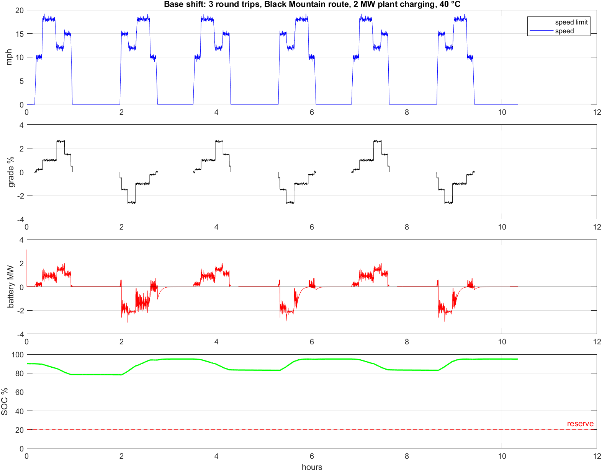
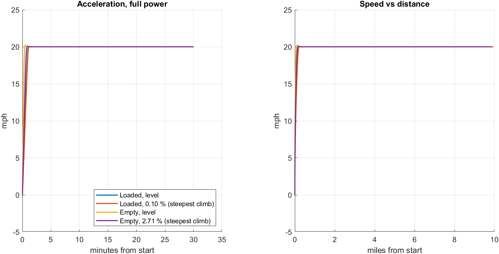
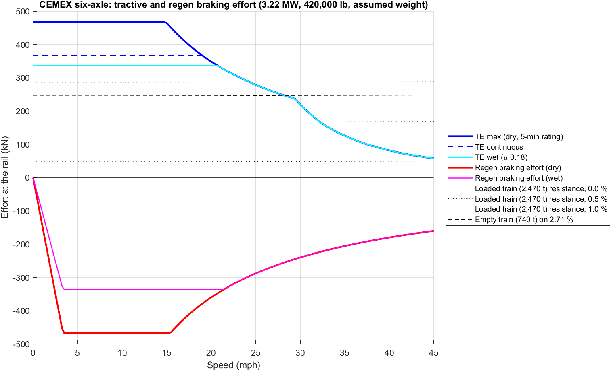
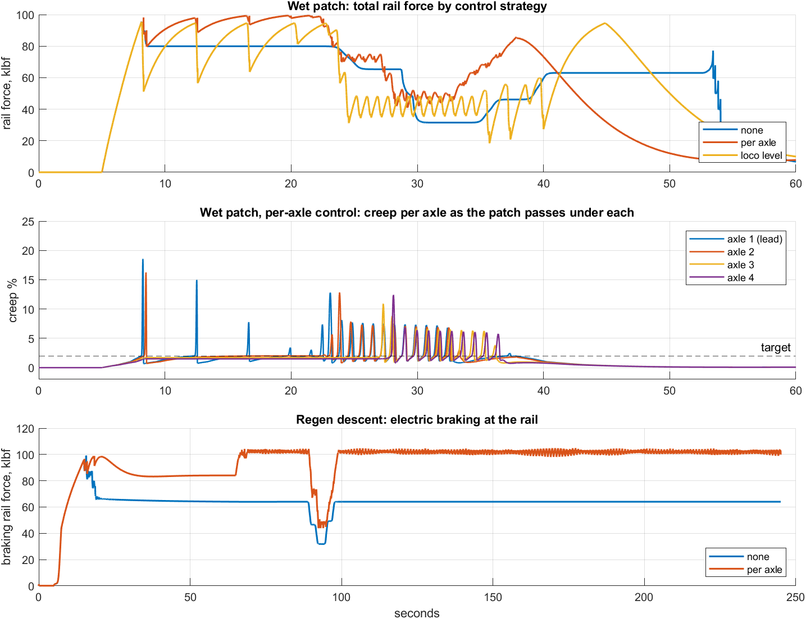
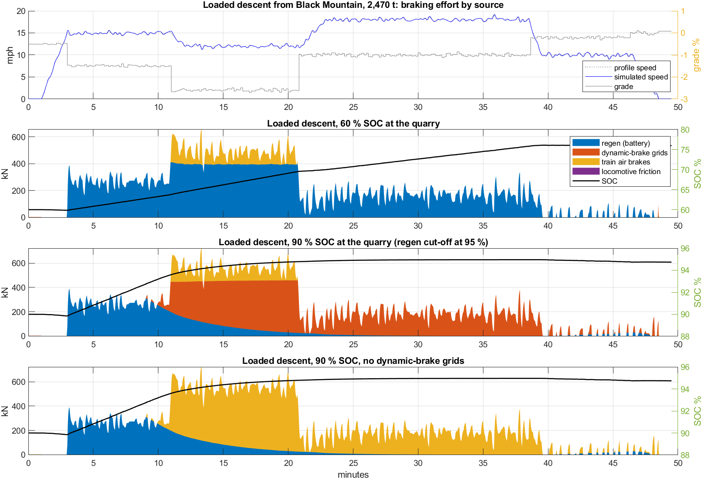
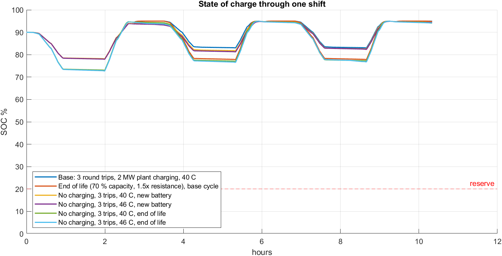
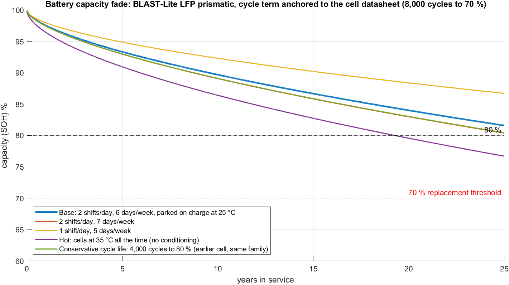
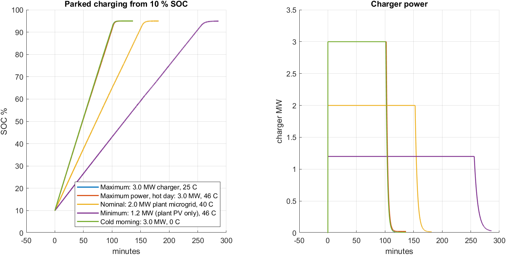
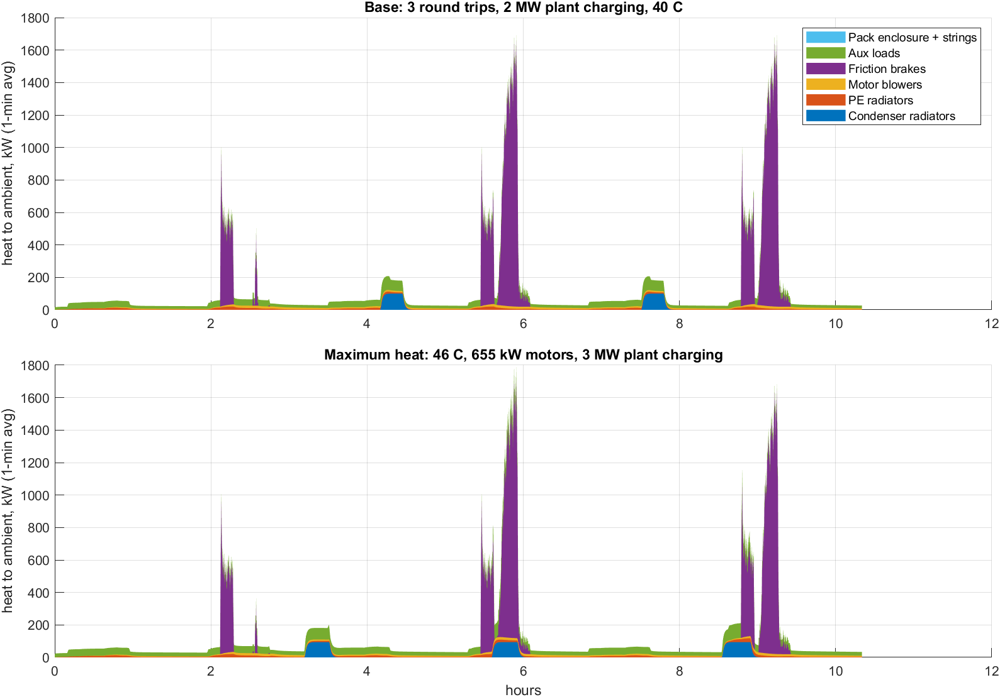

# CEMEX Victorville RFI #13544: simulation answers

Generated 2026-10-28 21:39 by `cemex/cemex_rfi_report.m` from the CEMEX parallel model (CEMEX-A, built on GP40 proto RevE).

> **Route and inputs.** Duty cycle on the Black Mountain Quarry -> Victorville plant run profile (EMD SD40-2, 11.0 mi, 48 min loaded): loaded downhill as run, empty uphill on the same profile reversed, grades -2.71 % to +2.71 %. Loaded train 2,470 t; **assumed:** empty train 740 t (30 % of loaded), locomotive weight 420,000 lb, operating schedule. Re-run `cemex_rfi_report('Rerun', true)` when these are confirmed.

Locomotive as simulated: 6 axles (6 × D77 DC traction motors, 62:15, 40 in wheels), 3.12 MW traction (4,183 hp) at the rail, battery 14 strings × 416S × 314 Ah LFP = 5,852 kWh, discharge limit 2,928 A (0.67C), charge and regen limit 2,198 A (0.50C), regen on, cooling system CEMEX-sized (6 chiller modules, 3 condenser banks, 2 PE banks). Adhesion 0.25 dry, 0.18 wet.

## B2: Power, speed, weight

| Item | Value | Basis |
|---|---|---|
| Continuous traction power | 3.22 MW motor output, 3.12 MW at the rail (4,183 hp) | 6 × 536 kW D77 rating, gear efficiency 0.97 |
| Peak battery power (simulated) | 2.00 MW | base duty cycle, includes aux and cooling |
| Short-time traction | 3.93 MW (6 × 655 kW, chopper rating) | `MotorCapkW` 655 option, discharge limit 0.81C |
| Full power available up to | 30 mph | armature voltage limit above that (750 V per motor) |
| Route top speed | 19 mph | route profile |
| Locomotive weight / axle load | 420,000 lb / 70,000 lb | assumed; weight study gives 390,400 lb lower bound at this battery size (see Locomotive weight) |
| Dimensions | not in the model | mechanical design |

## C1: Maximum sustained grade

Grade the locomotive can hold at constant speed on the continuous motor rating (1,050 A per D77, thermally unlimited), with the 5-minute rating (1,500 A) for comparison. Curvature counts as grade (0.04 %/degree). Values in %.

| Consist | mph | SOC 90 % | SOC 50 % | SOC 20 % | 5-min rating | Wet (μ 0.18) |
|---|---|---|---|---|---|---|
| Empty (740 t) | 5 | 4.14 | 4.14 | 4.14 | 5.33 | 3.78 |
| Empty (740 t) | 10 | 4.14 | 4.14 | 4.14 | 5.33 | 3.78 |
| Empty (740 t) | 15 | 4.14 | 4.14 | 4.14 | 5.30 | 3.78 |
| Empty (740 t) | 20 | 3.92 | 3.92 | 3.92 | 3.92 | 3.77 |
| Loaded (2,470 t) | 5 | 1.34 | 1.34 | 1.34 | 1.76 | 1.21 |
| Loaded (2,470 t) | 10 | 1.34 | 1.34 | 1.34 | 1.76 | 1.21 |
| Loaded (2,470 t) | 15 | 1.34 | 1.34 | 1.34 | 1.75 | 1.21 |
| Loaded (2,470 t) | 20 | 1.26 | 1.26 | 1.26 | 1.26 | 1.21 |
| Loaded +25 % (3,088 t) | 5 | 1.05 | 1.05 | 1.05 | 1.39 | 0.95 |
| Loaded +25 % (3,088 t) | 10 | 1.05 | 1.05 | 1.05 | 1.39 | 0.95 |
| Loaded +25 % (3,088 t) | 15 | 1.05 | 1.05 | 1.05 | 1.38 | 0.95 |
| Loaded +25 % (3,088 t) | 20 | 0.99 | 0.99 | 0.99 | 0.99 | 0.94 |

- **Battery charge doesn't change grade capability** above the 20 % reserve. The discharge limit is sized so full power holds down to 1,248 V, and the loaded pack stays at or above 1,319 V at 20 % SOC.
- **Ambient temperature doesn't change it either, up to 48 °C.** The 46 °C shift ran with no derating: battery discharge factor 1.00, verdict OPTIMAL, condenser 57.2 °C (limit 65 °C).
- The loaded direction has no real climb on this route (steepest +0.10 %).
- The route's steepest empty climb is 2.71 % for 2.0 mi. The empty train (740 t) holds it at 28.3 mph on the continuous rating (limit at 10 mph: 4.14 %).

**Short-time motor ratings (from the thermal model).** Time from a warm motor (80 °C) to 180 °C at constant current, 40 °C ambient. The model is lumped (one thermal mass, no winding hot spot), so it is optimistic for short-time duty: it gives 138 min at 1,150 A and 47 min at 1,500 A, where the D77's published ratings are 15 min and 5 min. Use the published ratings; the model's continuous point (1,050 A) matches.

| Current per motor, A | Steady temperature °C | Time to 180 °C |
|---|---|---|
| 1,050 | 180 | continuous |
| 1,150 | 208 | 138 min |
| 1,300 | 254 | 77 min |
| 1,500 | 325 | 47 min |


## C2: Duty-cycle simulation (Victorville route)

Inputs the simulation covers:

| RFI input | Value used |
|---|---|
| Route | Black Mountain Quarry -> Victorville plant run profile (EMD SD40-2, 11.0 mi, 48 min loaded) |
| Locomotive weight | 420,000 lb (assumed) |
| Train consist | 2,470 t loaded; 740 t empty (assumed, 30 % of loaded) |
| Grades / curvature | -2.71 % to +2.71 % as recorded (curvature included in the recorded grade) |
| Speed restrictions | as run, up to 19.2 mph |
| Acceleration | as run on the route profile, within adhesion and power |
| Stops / starts | 3 round trips; 60 min loading, 45 min unloading, stop at each end |
| Ambient | 40 °C (46 °C case below) |
| Auxiliary loads | `cemex_load_budget.csv` (blowers, compressor, cab, controls) plus cooling system from the thermal model |
| Braking | regen to 2,198 A (0.5C) and the traction power cap, cut off at 95 % SOC; dynamic-brake grids 3.2 MW; train air brakes beyond locomotive adhesion |
| Battery limits | discharge 2,928 A, charge 2,198 A, BMS temperature derates (45/50 °C hot) |
| Battery degradation | end-of-life case: 70 % capacity (8,000 cycles, Voltify response), 1.5× resistance (assumed) |
| Charging opportunities | 2000 kW during each plant unload dwell; none at the quarry |

Results, one shift:

| Case | Battery kWh | Out kWh | Regen kWh | Charger kWh | Peak MW | Min SOC % | End SOC % | Max shortfall mph | Condenser °C | Thermal |
|---|---|---|---|---|---|---|---|---|---|---|
| Base: 3 round trips, 2 MW plant charging, 40 C | 5,852 | 2,251 | 2,483 | 98 | 2.00 | 78.1 | 94.9 | 0.6 | 51.9 | OPTIMAL |
| End of life (70 % capacity, 1.5x resistance), base cycle | 4,096 | 2,258 | 2,454 | 47 | 2.05 | 72.9 | 94.8 | 0.6 | 51.9 | OPTIMAL |
| 46 C ambient, base cycle | 5,852 | 2,270 | 2,486 | 112 | 2.01 | 77.9 | 94.9 | 0.6 | 57.2 | OPTIMAL |
| Wet rail, adhesion 0.18, base cycle | 5,852 | 2,251 | 2,380 | 199 | 2.00 | 78.1 | 94.9 | 0.6 | 51.9 | OPTIMAL |
| No charging, 3 trips, 40 C, new battery | 5,852 | 2,289 | 2,591 | 0 | 2.00 | 78.1 | 94.5 | 0.6 | 51.9 | OPTIMAL |
| No charging, 3 trips, 46 C, new battery | 5,852 | 2,333 | 2,627 | 0 | 2.01 | 77.9 | 94.4 | 0.6 | 57.2 | OPTIMAL |
| No charging, 3 trips, 40 C, end of life | 4,096 | 2,302 | 2,513 | 0 | 2.05 | 72.9 | 94.1 | 0.6 | 51.9 | OPTIMAL |
| No charging, 3 trips, 46 C, end of life | 4,096 | 2,343 | 2,557 | 0 | 2.01 | 72.6 | 94.2 | 0.6 | 57.2 | OPTIMAL |



Every shift case finished with the train on schedule within the speed tolerance. The shortfall column is the worst gap below the profile speed (0.6 mph at most), where the locomotive is at its power or adhesion limit. Every case was thermally OPTIMAL.

## C3: Acceleration

Full-power start from rest at 40 °C, SOC 90 %. Time (s) and distance (m) to each speed. Blank means the train doesn't reach that speed on that grade.

| Case | t 5 mph | d 5 mph | t 10 mph | d 10 mph | t 15 mph | d 15 mph | t 20 mph | d 20 mph | Balancing mph |
|---|---|---|---|---|---|---|---|---|---|
| Loaded, level | 14 | 16 | 28 | 63 | 42 | 142 | 62 | 304 | 20.0 |
| Loaded, 0.10 % (steepest climb) | 15 | 17 | 30 | 68 | 45 | 154 | 66 | 322 | 20.0 |
| Empty, level | 5 | 5 | 9 | 21 | 14 | 47 | 24 | 130 | 20.0 |
| Empty, 2.71 % (steepest climb) | 10 | 11 | 20 | 45 | 30 | 103 | 47 | 239 | 20.0 |



## C4: Maximum train tonnage

Trailing short tons. Starting uses 467 kN (adhesion-limited; dry μ 0.25, wet 0.18). Continuous means holding 10 mph on the continuous motor rating. Coupler means a 250,000 lbf drawbar limit (assumed AAR knuckle working limit, to be confirmed against the CEMEX fleet).

| Grade % | Starting, dry | Starting, wet | Continuous 10 mph | Coupler limit |
|---|---|---|---|---|
| 0.00 | 26,040 | 18,690 | 20,415 | 62,479 |
| 0.10 | 17,290 | 12,390 | 13,540 | 41,652 |
| 0.50 | 7,290 | 5,190 | 5,683 | 17,851 |
| 1.00 | 4,165 | 2,940 | 3,227 | 10,413 |
| 1.50 | 2,878 | 2,014 | 2,216 | 7,350 |
| 2.00 | 2,176 | 1,508 | 1,665 | 5,680 |
| 2.71 | 1,594 | 1,089 | 1,208 | 4,294 |

The coupler is never the limit for one locomotive: maximum drawbar pull is 105,036 lbf, against the 250,000 lbf limit. Adhesion is the limit at starting speeds.

## C5: Energy, peak demand and state of charge, one operating cycle

| Metric | Base shift (3 round trips) | Per round trip |
|---|---|---|
| Battery energy out | 2,251 kWh | 750 kWh |
| Regen returned to battery | 2,483 kWh | 828 kWh |
| Net battery energy (no charging) |  | -93 kWh (no-charging run; negative = net gain) |
| Charger energy in (plant dwells) | 98 kWh |  |
| Peak demand (battery) | 2.00 MW |  |
| Highest 5-minute average | 1.54 MW |  |
| SOC start / minimum / end | 90 % / 78.1 % / 94.9 % |  |
| Required reserve | 20 %: yes |  |

## C6: Wet, dusty, low-adhesion and high-temperature performance

- **Low adhesion.** At μ 0.18 starting TE drops from 467 to 336 kN. The wet base shift still finished with minimum SOC 78.1 %, but ran 0.0 min more than 2 mph below the speed limit on the heavy pulls (dry: 0.0 min). Sanding and adhesion control are in scope; the model uses one adhesion value for the whole locomotive and has no per-axle slip control.
- **High temperature.** At 46 °C the shift ran with no derating: discharge factor 1.00, cell max 28.0 °C, condenser 57.2 °C, PE margin 7.8 K, verdict OPTIMAL. The cooling system was sized to stay OPTIMAL to 48 °C.
- **Derating logic (as modeled).**
  - Battery: the BMS derates current linearly from 45 °C (L1) to 50 °C (L2) cell temperature hot, and from 5 °C to 3 °C cold. The pack is held at 25 °C while parked.
  - Motors: current limit of 1,500 A for 5 minutes and 1,050 A continuous per motor.
  - Cooling: chiller capacity falls as the condenser supply rises, and cuts out at 65 °C.
  - Adhesion: TE is capped at μ × locomotive weight.
- **Dust.** Dust isn't a model input. In the model it shows up only as reduced adhesion (use the wet case) and radiator fouling (UA margin: the condenser runs 7.8 K under its limit at 46 °C).



**Ambient envelope** (base duty cycle, pack held at 25 °C while parked):

| Ambient | Verdict | Condenser max °C (65) | PE margin K | Cell °C | Discharge derate factor | Cooling/heating kWh | Min SOC % |
|---|---|---|---|---|---|---|---|
| -10 °C | OPTIMAL | -10.0 | 66.7 | 16.6-25.0 | 1.00 | 64 | 78 |
| 0 °C | OPTIMAL | 0.0 | 56.7 | 19.5-25.0 | 1.00 | 64 | 78 |
| 40 °C | OPTIMAL | 51.9 | 13.1 | 25.0-28.0 | 1.00 | 164 | 78 |
| 46 °C | OPTIMAL | 57.2 | 7.8 | 25.0-28.0 | 1.00 | 240 | 78 |
| 48 °C | OPTIMAL | 58.9 | 6.1 | 25.0-28.0 | 1.00 | 242 | 78 |
| 50 °C | OPTIMAL | 60.7 | 4.3 | 25.0-28.0 | 1.00 | 262 | 78 |
| 52 °C | OK | 62.5 | 2.5 | 25.0-28.0 | 1.00 | 267 | 78 |

Full performance with no derating from -10 °C to 50 °C. Above that, the verdict column shows how the margins close. Cold mornings are covered by the pack heater and conditioning on the charger; the cell stays inside its window.

## C7: Steepest grade to start, restart and hold

| Consist | Start / restart, dry % | Start / restart, wet % | Hold, locomotive brake only % |
|---|---|---|---|
| Empty (740 t) | 5.33 | 3.78 | 5.7 |
| Loaded (2,470 t) | 1.76 | 1.21 | 2.2 |
| Loaded +25 % (3,088 t) | 1.39 | 0.95 | 1.8 |

**Method.** Starting TE (adhesion-limited) against grade plus rolling resistance, with no acceleration margin. It is checked in simulation with the loaded train:

- at 1.70 %: reaches 0.7 mph.
- at 1.85 %: the train creeps to 0.06 mph and stalls. The anti-rollback brake stops any rollback within 0.06 mph.

Rollback is prevented by the park/anti-rollback brake whenever speed is commanded to zero or the train rolls back. With the locomotive brake alone, the loaded train holds up to 2.16 %.

**Route impact (empty).** The empty train can restart anywhere on the route, wet or dry: its steepest climb is 2.71 %, against a wet restart limit of 3.78 %.

## C8: Limitations and assumptions

1. The empty-train weight, locomotive weight and operating schedule are assumptions; the train air brake capacity (3 % of trailing weight) needs CEMEX car brake data.
2. Wet-rail restart limits: loaded train 1.21 % (route climb 0.10 %), empty train 3.78 % (route climb 2.71 %); see C7.
3. Without charging, the route is net energy-positive, so the battery doesn't drain toward the reserve (E3). Leave the plant at or above 38 % SOC to cover the empty-climb dip with reserve.
4. The locomotive alone can hold the loaded train on descents up to 2.16 %. The route's -2.71 % loaded descent needs the train air brakes as well (D3, D4).
5. Not modeled: individual-axle slip control (the model uses one adhesion value).
6. The cell rating at 0.67C continuous discharge needs confirmation from the cell supplier. Victorville's design ambient is assumed to be 46 °C.

## D1: Tractive effort

| Item | Value |
|---|---|
| Starting TE (dry, μ 0.25) | 467 kN (105,036 lbf), adhesion-limited |
| Starting TE, motor current limit | 562 kN (6 × 1,500 A) |
| Continuous TE | 367 kN (82,550 lbf) at 19.0 mph (6 × 1,050 A) |
| Continuous speed at maximum power | 19.0 mph |
| Wet starting TE (μ 0.18) | 336 kN (75,626 lbf) |

| mph | TE max kN | TE continuous kN | TE wet kN | Regen braking kN | TE max limited by |
|---|---|---|---|---|---|
| 0 | 467 | 367 | 336 | 0 | adhesion |
| 2 | 467 | 367 | 336 | 278 | adhesion |
| 5 | 467 | 367 | 336 | 467 | adhesion |
| 8 | 467 | 367 | 336 | 467 | adhesion |
| 10 | 467 | 367 | 336 | 467 | adhesion |
| 12 | 467 | 367 | 336 | 467 | adhesion |
| 15 | 465 | 367 | 336 | 467 | motor power |
| 20 | 349 | 349 | 336 | 360 | motor power |
| 25 | 279 | 279 | 279 | 288 | motor voltage |
| 30 | 220 | 220 | 220 | 240 | motor voltage |
| 40 | 82 | 82 | 82 | 180 | motor voltage |

Full curve: `D1_te_be_vs_speed.csv`.

**Against the reference locomotive.** CEMEX's Victorville fleet has run second-hand EMD SD40-2s and SD60s (and GP39-2s). The RFI's 3,500-3,800 hp reference matches the **SD60 (3,800 hp)**.

Published ratings vary between sources; these are the most-cited values:

- **SD60:** 98,250 lbf starting at 25 % adhesion; 100,000 lbf continuous at 9.8 mph; D87B motors, 77:17; about 368,000 lb
- **SD40-2:** 115,000 lbf starting at 31.5 %; 82,100 lbf continuous at 11 mph; D77 motors, 62:15

Beyond each unit's continuous point, its curve is drawn at the rail power implied by that point: TE × mph / 375. Values below are continuous ratings in lbf.

| Locomotive | Starting TE lbf | Continuous TE lbf | Rail hp at continuous point | 5 mph | 10 mph | 15 mph | 20 mph |
|---|---|---|---|---|---|---|---|
| EMD SD60 (reference, 3,800 hp) | 98,250 (25 % adh.) | 100,000 @ 9.8 mph | 2,613 | 100,000 | 98,000 | 65,333 | 49,000 |
| EMD SD40-2 (3,000 hp) | 115,000 (31.5 % adh.) | 82,100 @ 11.0 mph | 2,408 | 82,100 | 82,100 | 60,207 | 45,155 |
| CEMEX battery loco, 62:15 (as modeled) | 105,036 (0.25 × 420,000 lb) | 82,550 @ 19.0 mph | 4,183 | 82,550 | 82,550 | 82,550 | 78,438 |
| CEMEX battery loco, 77:17 regear | 105,036 (0.25 × 420,000 lb) | 90,460 @ 17.2 mph | 4,161 | 90,460 | 90,460 | 90,460 | 78,438 |

What this shows:

- **Continuous TE at low speed is short of the SD60.** As modeled (SD40-2 drivetrain: D77, 62:15) the locomotive matches the SD40-2 but is 17,450 lbf below the SD60 continuous rating. It equals or exceeds the SD60 from 12.0 to 35 mph, where its higher rail power (4,183 hp vs about 2,613) takes over. Above 35 mph the 750 V-per-motor limit inherited from the GP40 proto cuts power; that is outside the 20 mph route but contradicts the "no high-speed power fall-off" in Voltify's questionnaire answer (B9).
- **A 77:17 regear** (the SD60 ratio) raises continuous TE to 90,460 lbf and crosses the SD60 from 11.0 mph. Full continuous power then starts at 17.2 mph instead of 19.0 mph. The cost is top speed, which falls by the same 8.7 %; that doesn't matter on a 20 mph quarry line.
- **Closing the rest of the gap at 10 mph** takes more current than the D77 continuous rating (1,050 A), or a larger motor (D87/D90). Matching the SD60 low-speed rating is a motor and blower decision, not a battery or power question: the battery locomotive has about 60 % more rail power.
- **Starting TE depends on weight and adhesion, not the motors.** Six D77s at their 5-minute current give 126,328 lbf. The value in the table is adhesion-limited at μ 0.25 on the placeholder weight. The SD60's published figure assumes 25 % on about 393,000 lb. At SD60 weight (368,000 lb) the battery locomotive would start at 92,000 lbf, so it needs its battery ballast (420,000 lb is within the 70,000 lb axle load) or better adhesion from per-axle control (D2) to match.

## Locomotive weight (B2, C7, D1, D4)

**Weight estimate.** From Voltify's battery locomotive weight study (SD40 core):

- a fixed 290,364 lb for the frame, trucks, six DC traction motors, compressor, grids, charger, pantographs and power electronics;
- plus 17.1 lb per kWh of installed battery (packs, racks and thermal management).

At 5,852 kWh that gives **390,440 lb (65,073 lb per axle)**. This is a lower bound: the study lists the cab, inverter, cabling, breakers and contactor panels without weights. The simulations use 420,000 lb.

Weight sets adhesion, so it sets starting tractive effort and how much braking the locomotive can do on its own. Motor ratings and power don't change.

| Case | Weight lb | Axle lb | Starting TE lbf (μ 0.25) | vs SD60 98,250 | Loaded start grade % dry / wet | Empty start grade % | Loco-only hold % (loaded) | Stop from 20 mph on -2.71 %, ft | Descent regen kWh | Descent train air kWh |
|---|---|---|---|---|---|---|---|---|---|---|
| SD60 reference weight | 368,000 | 61,333 | 92,031 | -6,219 | 1.53 / 1.05 | 4.78 | 1.93 | 685 | 954 | 134 |
| Weight study at 5.85 MWh (lower bound) | 390,400 | 65,067 | 97,633 | -617 | 1.63 / 1.12 | 5.02 | 2.03 | 657 | 975 | 113 |
| Base case (assumed) | 420,000 | 70,000 | 105,036 | 6,786 | 1.76 / 1.21 | 5.33 | 2.16 | 624 | 1,001 | 86 |
| Weight of a 9.4 MWh build | 450,700 | 75,117 | 112,713 | 14,463 | 1.89 / 1.30 | 5.64 | 2.29 | 593 | 1,026 | 59 |

- **Starting tractive effort vs the SD60:** at the SD60's own weight the battery locomotive starts 6,219 lbf below it at the same 25 % adhesion; the SD60's 98,250 lbf corresponds to about 393,000 lb. At the weight-study estimate it is 617 lbf below.
- **Route capability doesn't depend on it:** across the whole range the empty train restarts on more than 4.8 % (route climb 2.71 %), and every shift completes with the same energy (2,194-2,285 kWh out).
- **Heavier brakes more electrically:** on the loaded descent the car air brakes carry 134 kWh at 368,000 lb and 59 kWh at 450,700 lb, because more locomotive weight means more adhesion for regen.
- **Axle load:** the base case is 70,000 lb per axle. The 9.4 MWh build (75,117 lb per axle) would need track and bridge clearance.

## Closing the gap to the SD60 (D1)

The battery locomotive's continuous tractive effort below about 12 mph is set by the D77 continuous current (1,050 A per motor). Three levers, and what each does:

**1. Motor cooling: the continuous current.** The motor thermal model settles at 180 °C at 1,051 A per motor at 40 °C (1,028 A at 46 °C), which reproduces the D77 continuous rating. Matching the SD60's 98,000 lbf at 10 mph needs about **1,210 A per motor at 62:15**, or **1,125 A at 77:17**. That means about 33 % or 15 % more blower cooling (heat removed per kelvin rises with the square of the current), plus the motor supplier's agreement to a higher continuous rating.

**On this route the continuous rating barely matters.** The motor's thermal time constant is 91 minutes, and the steepest climb (2.71 % for 2.0 mi, empty train) takes only minutes. The base shift peaks at 78 °C motor temperature, against 180 °C.

**2. Regear to 77:17.** This raises continuous TE by 9.6 % (to 90,460 lbf) at the cost of top speed. On the route:

|  | 62:15 (as modeled) | 77:17 |
|---|---|---|
| Shift: battery out / regen, kWh | 2,251 / 2,483 | 2,235 / 2,481 |
| Shift: max motor temperature, °C | 78 | 72 |
| Shift: worst speed shortfall, mph | 0.6 | 0.6 |
| Empty train on 2.71 %: 0-15 mph, s | 30 | 30 |
| Loaded descent (60 % SOC): regen / train air, kWh | 1,001 / 86 | 1,015 / 86 |

The regear changes little on this route: the duty is adhesion- and power-limited, not current-limited. It earns its place only if the reference comparison at 5-10 mph matters to CEMEX.

**3. Motor voltage: the high-speed fall-off.** The model inherits the GP40 prototype's 750 V armature limit per motor. The CEMEX pack is 1,331 V nominal, so a chopper and motor arrangement that uses more of the bus voltage keeps full power to higher speed:

| Armature limit per motor | Full power up to | TE at 30 mph, lbf | TE at 40 mph, lbf | TE at 45 mph vs full power, lbf |
|---|---|---|---|---|
| 750 V | 30 mph | 49,473 | 18,438 | 12,990 of 34,861 |
| 1,000 V | 44 mph | 52,292 | 39,219 | 32,585 of 34,861 |
| 1,265 V | 45 mph or more | 52,292 | 39,219 | 34,861 of 34,861 |

Voltify's questionnaire answer (B9) describes 1.5 kV power electronics with no high-speed fall-off; that corresponds to the 1,000 V and higher rows here. The motor's voltage rating and the chopper topology (motors in series pairs, or one chopper each) need to be confirmed before the curve is quoted. None of this affects the 20 mph Black Mountain route.

## D2: Individual-axle slip and slide control

For this question the model gives each axle its own wheelset speed. Each wheelset is coupled to the rail through an adhesion-versus-creep curve that peaks at 2 % creep and falls to 60 % of the peak at full spin, the usual shape for steel on steel. Each axle has its own controller. The controller cuts that axle's torque while its creep is above 2 %, then restores the torque over about 2 s. Per-axle control needs one power controller per motor, or per motor pair; the chopper arrangement is still to be confirmed (see D1). Two alternatives are run for comparison:

- **no slip control;**
- **locomotive-level control:** every axle cut to the factor of the worst axle, as on a locomotive where several motors share one power control.

Three cases, all with the loaded 2,470 t train:

1. **Dry-rail start.** Starting on level track and accelerating to 10 mph. The rail gives 25 % adhesion at the creep peak, and the controller asks for 30 %. As tractive effort builds, weight transfer unloads the lead axle of each truck (lead axle 10 % lighter at full adhesion, assumed).
2. **Wet patch.** The same start, crossing a 30 m wet patch where adhesion halves. The controller asks for 25 %.
3. **Regen slide.** Holding 12 mph down the 2.71 % grade on regen, over a 30 m wet patch; electric braking is asked for at 30 % adhesion.

| Case | Control | Time to 10 mph | Mean rail force, lbf (adhesion used) | Peak creep | Time above 10 % creep |
|---|---|---|---|---|---|
| 1. Dry-rail start | No slip control | 48 s | 62,629 (60 %) | spin, wheels at 12x train speed | 47.2 s |
|  | **Per-axle control** | 33 s | 84,906 (81 %) | 22 % | 1.2 s |
|  | Locomotive-level control | 38 s | 76,700 (73 %) | 19 % | 0.5 s |
| 2. Wet patch | No slip control | 48 s | 62,836 (60 %) | spin, wheels at 11x train speed | 45.8 s |
|  | **Per-axle control** | 39 s | 74,068 (71 %) | 19 % | 0.7 s |
|  | Locomotive-level control | 48 s | 62,841 (60 %) | 21 % | 1.0 s |
| 3. Regen slide | No slip control | - | 63,001 (60 %) | wheels locked | 229.9 s |
|  | **Per-axle control** | - | 99,828 (95 %) | 14 % | 0.8 s |

*Mean rail force is taken while accelerating (cases 1-2) or while holding speed on the grade (case 3). Adhesion used is relative to 25 % of the 420,000 lb locomotive weight. Peak creep includes a short spike of under 1 s at starting, before the controller catches it.*

What the runs show:

- **Without slip control, the wheels spin or lock.** In traction, wheel speed reaches about 12 times train speed, and the wheels spend 47 s above 10 % creep. In braking, the wheels lock (100 % creep) for most of the descent and the train air brakes have to hold the train. That means flat spots and rail burns: slip control is not optional.
- **Per-axle control holds every axle near its own adhesion peak.** On dry rail the locomotive uses 81 % of the available adhesion and reaches 10 mph in 33 s. Locomotive-level control uses 73 % and takes 38 s, because every axle is held back to the lightest (lead) axle.
- **On the wet patch, only the axle on the patch backs off.** The other axles keep pulling and recover each in turn as the patch passes under them. Mean rail force is 74,068 lbf, against 62,841 lbf when every axle is cut together.
- **Slide control works the same way under regen.** It holds 99,828 lbf of electric braking, against 63,001 lbf with locked wheels and none. The train air brakes then do less of the work: 42 kWh against 90 kWh over the run.



Limitations: the creep curve, weight transfer and controller gains are generic, not measured on CEMEX rail. The modeled controller is deliberately simple. It cuts torque and recovers in cycles of about 1 Hz on the wet patch (see the creep trace), so a production creep controller should do at least as well. The model has four axle units, each one 1.5 motors, so "per axle" here means per axle unit of 1.5 motors; the locomotive needs one controller per motor, or per motor pair, to match this. Dynamic-brake grid effort is applied directly at the rail in the model, so the slide case covers regen braking only. Final evidence for D2 is a slip/slide test on the locomotive (sanding off, wet rail), which the model can be fitted to.

## D3: Brake blending

As simulated, the speed controller asks for one braking effort, which is met automatically at every time step in this order:

1. **Regen to the battery,** up to the smallest of adhesion, the traction power cap and the charge current limit (2,198 A, scaled by the battery temperature factor). Regen tapers to zero as the battery goes from 92 % to 95 % SOC, and fades out below 3.4 mph.
2. **Dynamic-brake grids** (3.2 MW), for whatever regen cannot take: battery full or charge-limited. Grid effort fades below 5 mph, and regen plus grids stay within adhesion.
3. **Train air brakes** on the cars, for demand beyond what the locomotive can hold by adhesion. Up to 3 % of the trailing weight (assumed until CEMEX gives car brake data).
4. **Locomotive friction brakes** last, with the locomotive's total braking kept within adhesion.

**Evidence: the loaded run down from Black Mountain** (2,470 t), from three arrival states:

- **60 % SOC at the quarry:** regen 1,001 kWh, grids 0 kWh, train air 86 kWh, locomotive friction 0 kWh. Speed held within +0.8 / -0.5 mph of the profile; SOC 60 % → 76 % (peak 76.1 %).
- **90 % SOC at the quarry (regen cut-off at 95 %):** regen 320 kWh, grids 772 kWh, train air 96 kWh, locomotive friction 0 kWh. Speed held within +0.8 / -0.6 mph of the profile; SOC 90 % → 95 % (peak 95.0 %).
- **90 % SOC, no dynamic-brake grids:** regen 320 kWh, grids 0 kWh, train air 868 kWh, locomotive friction 0 kWh. Speed held within +0.8 / -0.6 mph of the profile; SOC 90 % → 95 % (peak 95.0 %).

The transitions are automatic. When the battery fills, regen hands over to the grids with no change in speed. Without grids, the friction brakes take over. The car air brakes carry only the share of the steepest grade that exceeds the locomotive's adhesion.

## D4: Braking effort and stopping distance

Regen braking effort vs speed is in the D1 table and figure. Stopping distances are given two ways:

- **Locomotive alone:** regen, grids and locomotive friction, up to adhesion.
- **With train air brakes:** plus car brakes at 3 % of trailing weight (assumed full-service retardation; to be refined with CEMEX car brake ratios).

"Cannot stop" means the grade force exceeds that braking on its own. Grades are the route's steepest descents.

| Consist | Grade % | From mph | μ | Loco alone: time s | Loco alone: ft | With train air: time s | With train air: ft |
|---|---|---|---|---|---|---|---|
| Empty | 0.00 | 10 | 0.25 | 8 | 61 | 6 | 43 |
| Empty | 0.00 | 10 | 0.18 | 11 | 83 | 7 | 53 |
| Empty | 0.00 | 15 | 0.25 | 12 | 137 | 9 | 97 |
| Empty | 0.00 | 15 | 0.18 | 17 | 187 | 11 | 120 |
| Empty | 0.00 | 20 | 0.25 | 17 | 243 | 12 | 173 |
| Empty | 0.00 | 20 | 0.18 | 23 | 333 | 15 | 213 |
| Empty | -0.10 | 10 | 0.25 | 8 | 62 | 6 | 44 |
| Empty | -0.10 | 10 | 0.18 | 12 | 85 | 7 | 54 |
| Empty | -0.10 | 15 | 0.25 | 13 | 139 | 9 | 98 |
| Empty | -0.10 | 15 | 0.18 | 17 | 192 | 11 | 122 |
| Empty | -0.10 | 20 | 0.25 | 17 | 247 | 12 | 175 |
| Empty | -0.10 | 20 | 0.18 | 23 | 341 | 15 | 217 |
| Loaded | 0.00 | 10 | 0.25 | 22 | 160 | 10 | 70 |
| Loaded | 0.00 | 10 | 0.18 | 29 | 215 | 11 | 79 |
| Loaded | 0.00 | 15 | 0.25 | 33 | 360 | 14 | 158 |
| Loaded | 0.00 | 15 | 0.18 | 44 | 483 | 16 | 178 |
| Loaded | 0.00 | 20 | 0.25 | 44 | 640 | 19 | 281 |
| Loaded | 0.00 | 20 | 0.18 | 58 | 858 | 22 | 316 |
| Loaded | -2.71 | 10 | 0.25 | cannot stop | cannot stop | 21 | 156 |
| Loaded | -2.71 | 10 | 0.18 | cannot stop | cannot stop | 28 | 207 |
| Loaded | -2.71 | 15 | 0.25 | cannot stop | cannot stop | 32 | 351 |
| Loaded | -2.71 | 15 | 0.18 | cannot stop | cannot stop | 42 | 467 |
| Loaded | -2.71 | 20 | 0.25 | cannot stop | cannot stop | 43 | 624 |
| Loaded | -2.71 | 20 | 0.18 | cannot stop | cannot stop | 57 | 829 |

## D5: Regenerative energy recovery

- **Per shift:** regen returns 2,483 kWh to the battery, 828 kWh per round trip. That is 75 % of the braking energy; 575 kWh goes to the grids and 258 kWh to friction (train air and locomotive).
- **Regen vs battery output:** regen returns 110 % of what the battery delivers over the shift.
- **End of life:** 2,454 kWh per shift. **Wet rail:** 2,380 kWh per shift.

Limiting assumptions:

- regen limited to 0.5C charge current and the 3.22 MW traction cap
- fades below 3.4 mph
- drivetrain efficiency 0.88 each way
- regen tapers out between 92 % and 95 % SOC; above that the grids take the braking
- the battery's state at the top of each descent sets the split (D6): arriving at the quarry with headroom recovers the whole descent

## D6: Thermal management on long descents

The loaded run down from Black Mountain (2,470 t, 11.0 mi, steepest -2.71 % for 2.0 mi), 40 °C:

| Case | SOC % | Peak regen MW (1 s) | Charge A (1 s) / limit | Regen kWh | Grids kWh | Train air kWh | Loco friction kWh | Motor °C | Cell °C | Verdict |
|---|---|---|---|---|---|---|---|---|---|---|
| 60 % SOC at the quarry | 60→76 | 2.83 | 2,039 / 2,198 | 1,001 | 0 | 86 | 0 | 71 | 26.0 | OPTIMAL |
| 90 % SOC at the quarry (regen cut-off at 95 %) | 90→95 | 2.60 | 1,853 / 2,198 | 320 | 772 | 96 | 0 | 49 | 25.6 | OPTIMAL |
| 90 % SOC, no dynamic-brake grids | 90→95 | 2.60 | 1,853 / 2,198 | 320 | 0 | 868 | 0 | 49 | 25.6 | OPTIMAL |

- **Continuous braking.** Regen and the grids together give continuous electric braking down the whole descent, with no duty-cycle limit. Regen energy goes into the battery as charge, and its losses go to the cooling loops, which stay within limits. Grid heat goes straight to the air.
- **Battery headroom is the lever.** Arriving at the quarry at 60 % SOC, the battery absorbs 1,001 kWh, the whole descent except the car-brake share. Arriving at 90 %, it fills to 95 %, and the grids burn 772 kWh that could have been stored.
- **Operating recommendation:** plan plant charging so the locomotive leaves the plant with enough headroom for the loaded descent. Regen then refills it for free.
- **Without grids** at full SOC, the same energy goes to friction brakes (0 kWh locomotive, 868 kWh train air). That is wear and heat, not a speed limit.



**How far the battery can brake a descent:** on this route the loaded descent adds 1.46 % SOC (91 kWh) per mile. Before regen cuts off at 92 %, that gives:

| SOC at the top of the descent | Descent before regen cut-off |
|---|---|
| 40 % | 35.7 mi |
| 60 % | 22.0 mi |
| 80 % | 8.2 mi |
| 90 % | 1.4 mi |

Past that point the grids take over, so the descent length is not limited, only the share of energy recovered.

## E1: Battery

| Item | Value |
|---|---|
| Chemistry / supplier | LFP, 314 Ah prismatic cells |
| Configuration | 14 strings × 416S |
| Installed capacity | 5,852 kWh |
| Usable capacity (90 % → 20 % reserve) | 4,096 kWh |
| Nominal voltage | 1,331 V (416 × 3.2 V) |
| Maximum discharge | 2,928 A (0.67C), about 3.9 MW |
| Maximum charge / regen | 2,198 A (0.50C), about 2.9 MW |

## E2: Cycle completion at beginning and end of life

Base duty cycle (3 round trips, plant charging):

|  | Beginning of life | End of life (70 %) |
|---|---|---|
| Capacity | 5,852 kWh | 4,096 kWh |
| Minimum SOC | 78.1 % | 72.9 % |
| End SOC | 94.9 % | 94.8 % |
| Reserve 20 % held | yes | yes |
| Thermal verdict | OPTIMAL | OPTIMAL |

## E3: Range and operating hours

No charging, starting at 90 % SOC: 3-trip runs, extrapolated per round trip. Negative energy means the round trip returns more to the battery than it takes.

| Scenario | Net kWh per round trip | SOC change per trip % | Deepest dip in shift % | Lowest safe start SOC % | Round trips to reserve | Hours to reserve |
|---|---|---|---|---|---|---|
| No charging, 3 trips, 40 C, new battery | -93 | +1.6 | 12.5 | 32 | unlimited | unlimited |
| No charging, 3 trips, 46 C, new battery | -93 | +1.6 | 12.7 | 33 | unlimited | unlimited |
| No charging, 3 trips, 40 C, end of life | -65 | +1.6 | 17.9 | 38 | unlimited | unlimited |
| No charging, 3 trips, 46 C, end of life | -65 | +1.6 | 18.3 | 38 | unlimited | unlimited |

**On this route the locomotive is net energy-positive.** The loaded descent returns more energy than the empty climb takes, so the battery never runs down toward the reserve, new or at end of life. The constraint is instead the SOC dip on each empty climb: up to 12.5 % (17.9 % at end of life). Leaving the plant at or above 38 % keeps the 20 % reserve on every trip.

The plant charger becomes a top-up for auxiliaries and losses, not the energy source: the base shift draws only 98 kWh from it. Charging high actually costs energy: above 92 % SOC the descent regen goes to the grids (D6).



## E4: Battery degradation

**Model.** NREL BLAST-Lite `Lfp_Gr_250AhPrismatic`: a semi-empirical model for large-format LFP/graphite prismatic cells, fitted to published aging data (doi:10.1016/j.est.2023.109042), ported to MATLAB in `cemex_degradation.m`. It has two parts:

- **Calendar fade** grows with the square root of time. It speeds up with temperature and with high SOC, through the graphite anode potential.
- **Cycle fade** grows with charge throughput (equivalent full cycles), depth of discharge and C-rate.

**Anchored to the cell.** The cycle term is scaled (×0.82) so the model reproduces the cell manufacturer's 314 Ah datasheet: 8,000 cycles to 70 % at 25 °C, 0.5P/0.5P, 100 % DOD. The datasheet gives no calendar-aging curve, so the calendar term is BLAST's, unchanged. Against manufacturer data not used in the fit:

- **28-day storage at 50 % SOC:** the model keeps 99.7 % at 25 °C and 99.0 % at 45 °C. The datasheet specifies at least 98 % and 97 % recovery, so the model is consistent.
- **Cycles to 80 % at 0.5C/0.5C:** the model gives 4,649 at 25 °C and 5,835 at 45 °C. An earlier cell from the same manufacturer and family is rated 4,000 and 1,800. The model under-predicts heat damage from cycling at 45 °C. The CEMEX pack runs at 25-28 °C, where the anchor applies; the conservative case below covers the cycle-life uncertainty.

**Duty.** The base shift simulated above, using its SOC and cell temperature second by second. That is 0.39 equivalent full cycles per shift, including the plant charging. Between shifts the pack sits on charge at 95 % SOC, held at 25 °C by the cooling system. **The operating schedule is a placeholder**; CEMEX hasn't given shifts per day or days per year.

| Case | Full cycles / yr | SOH 5 y % | 10 y % | 15 y % | 20 y % | Years to 80 % | Years to 70 % | Calendar share of fade % |
|---|---|---|---|---|---|---|---|---|
| Base: 2 shifts/day, 6 days/week, parked on charge at 25 °C | 223 | 93.3 | 89.7 | 86.7 | 84.0 | > 25 | > 25 | 53 |
| 2 shifts/day, 7 days/week | 258 | 93.0 | 89.1 | 85.8 | 83.0 | > 25 | > 25 | 51 |
| 1 shift/day, 5 days/week | 93 | 94.9 | 92.3 | 90.2 | 88.4 | > 25 | > 25 | 71 |
| Hot: cells at 35 °C all the time (no conditioning) | 214 | 90.9 | 86.4 | 82.7 | 79.6 | 19.3 | > 25 | 71 |
| Conservative cycle life: 4,000 cycles to 80 % (earlier cell, same family) | 221 | 93.0 | 89.1 | 85.9 | 83.0 | > 25 | > 25 | 50 |



**What it means for CEMEX**

- **Replacement threshold: 70 % SOH.** E2 shows the base duty cycle still completes with reserve at 70 % capacity (minimum SOC 72.9 %). In the base case the pack reaches 70 % after more than 25 years.
- **Design life: 20 years**, the battery system design life. In the base case, SOH at 20 years is 84 %. The conservative cycle-life case gives 83 %.
- **Calendar aging is about half the fade.** At 223 full cycles a year, the pack is far from its 8,000-cycle rating. Time, temperature and resting SOC matter as much as use.
- **Temperature is the biggest lever.** Without conditioning (35 °C) the pack reaches 80 % at 19.3 instead of > 25. That supports the TMS holding the pack at 25 °C while parked.
- **Proposed warranted retention:** at least 85 % at 10 years. This is the conservative-case value, rounded down 4 points for margin. It is subject to a back-to-back warranty from the battery supplier and to the confirmed CEMEX schedule.

Limits:

- capacity only; resistance growth is assumed at 1.5× at end of life (E2) and not modeled
- BLAST fit range 10-45 °C, charge rate up to 0.65C (the regen and charge limit is 0.5C, inside the range)
- assumed operating schedule
- the cell datasheet revision is still to be confirmed with the manufacturer

To make E4 a warranted figure, we need from the battery supplier:

- calendar aging at 25, 35 and 45 °C and at several SOCs
- cycle life at 35-45 °C
- the pack-level warranty curve

## F2: Charging time

Parked charging, pack preconditioned to 25 °C. The BMS charge limit is 2,198 A (0.5C), about 3.0 MW at the battery, so a 3 MW charger is battery-limited. The "normal window" is from the lowest SOC in a 3-trip shift without charging (78 %, after the empty climb) back to 90 %.

| Condition | Peak MW | 10→80 % min | 20→90 % min | 78→90 % min | Cell max °C | Charger coolant °C | Verdict |
|---|---|---|---|---|---|---|---|
| Maximum: 3.0 MW charger, 25 C | 3.00 | 86 | 86 | 15 | 28.0 | 28.5 | OPTIMAL |
| Maximum power, hot day: 3.0 MW, 46 C | 3.00 | 86 | 86 | 15 | 28.1 | 49.8 | OPTIMAL |
| Nominal: 2.0 MW plant microgrid, 40 C | 2.00 | 129 | 129 | 22 | 28.0 | 42.8 | OPTIMAL |
| Minimum: 1.2 MW (plant PV only), 46 C | 1.20 | 216 | 217 | 38 | 28.0 | 48.1 | OPTIMAL |
| Cold morning: 3.0 MW, 0 C | 3.00 | 86 | 86 | 15 | 28.0 | 3.5 | OPTIMAL |



## F3: Utility demand (charging)

Demand at the locomotive comes from the simulations. Utility-side values assume a wayside converter efficiency of 97 % and power factor 0.95; power factor, harmonics and the converter's input voltage come from the charger specification, not the model.

| Scenario | Peak at locomotive kW | Peak at utility kW | Peak kVA | Utility kWh per event |
|---|---|---|---|---|
| Base duty cycle (2 MW plant windows) | 1,077 | 1,110 | 1,168 | 140 |
| Charger at full rating (3 MW, F2) | 3,000 | 3,093 | 3,256 | - |
| Full recharge 10 % -> 90 % at 3 MW | 3,000 | 3,093 | 3,256 | 4,925 |

- **On the Black Mountain duty cycle the charger is a top-up.** The base shift takes 140 kWh at the utility (281 kWh per day at 2 shifts), because the loaded descent recharges the battery (E3).
- **Size the service for the charger rating, not the duty cycle:** about 3,256 kVA for full-rate charging after an out-of-service day or a degraded-battery case. The plant microgrid (PV and battery storage) can cover the routine top-up and limit the utility demand charge.

## G5: Heat rejection (normal and emergency conditions)

Heat the locomotive rejects to the surrounding air, rebuilt second by second from the simulated thermal states with the model's own heat-path equations. Seven paths:

1. **Condenser radiators:** battery heat lifted by the chillers, plus compressor power.
2. **PE radiators:** chopper, onboard charger and inverter losses.
3. **Traction motor blowers:** motor copper losses.
4. **Friction brakes:** at the wheels.
5. **Auxiliary loads:** electrical input to the cab, compressor, blowers and controls, all ending as heat.
6. **Battery enclosure:** pack to ambient.
7. **String connection losses.**

Items 6 and 7 are grouped as "other". The pack enclosure runs below ambient on hot days, so it is a small heat *gain*.

| Case | Condenser kW | PE kW | Motors kW | Friction kW | Aux kW | Other kW | Total peak kW | Mean moving kW | Mean charging kW | Shift MWh |
|---|---|---|---|---|---|---|---|---|---|---|
| Base: 3 round trips, 2 MW plant charging, 40 C | 100 | 20 | 16 | 1442 | 85 | -3 | **1496** | 236 | 26 | 1.31 |
| 46 C ambient, base cycle | 94 | 24 | 16 | 1423 | 91 | -5 | **1585** | 245 | 49 | 1.37 |
| Maximum heat: 46 C, 655 kW motors, 3 MW plant charging | 94 | 24 | 16 | 1428 | 91 | -5 | **1591** | 244 | 50 | 1.37 |
| Fault, 46 C: condenser radiator fans failed | 32 | 20 | 16 | 1429 | 56 | -5 | **1487** | 242 | 60 | 1.39 |
| Fault, 46 C: PE radiator fans failed | 94 | 16 | 15 | 1463 | 76 | -4 | **1609** | 248 | 32 | 1.29 |
| Fault, 46 C: traction motor blowers failed | 94 | 24 | 7 | 1423 | 91 | -5 | **1576** | 239 | 43 | 1.32 |
| Fault, 46 C: VMS lost (radiator fans and chillers off) | 0 | 10 | 1 | 3224 | 0 | -5 | **3224** | 1408 | NaN | 3.34 |

Each path's figure is its highest 5-minute average in the shift. The paths peak at different times, so the "Total peak" column is the peak of the sum, not the sum of the peaks.



**Normal operation.** In the base case peak heat rejection is 1496 kW, which occurs while pulling. The shift total is 1.31 MWh of heat.

- Under way, about 236 kW goes to air on average.
- Regen covers all the braking on this route, so the friction brakes reject almost nothing.
- At 46 °C with 655 kW motors and 3 MW charging, the peak stays at 1591 kW. The radiators reject less per kelvin of coolant temperature, which is why the condenser runs hotter (57.2 °C vs 51.9 °C).

**Emergency (cooling-fault) conditions at 46 °C, base duty cycle:**

| Case | Condenser max °C | PE coolant max °C | Motor max °C | Cell max °C | Discharge derate factor | Min > 2 mph slow | Verdict | Limit reached |
|---|---|---|---|---|---|---|---|---|
| Maximum heat: 46 C, 655 kW motors, 3 MW plant charging | 57.2 | 49.4 | 84 | 28.0 | 1.00 | 0.0 | OPTIMAL |  |
| Fault, 46 C: condenser radiator fans failed | 64.9 | 48.9 | 84 | 28.0 | 1.00 | 0.0 | OK | PE margin 0.1 K |
| Fault, 46 C: PE radiator fans failed | 57.2 | 59.7 | 83 | 28.0 | 1.00 | 0.0 | FAIL | inverter fluid > 60 C |
| Fault, 46 C: traction motor blowers failed | 57.2 | 49.4 | 151 | 28.0 | 1.00 | 0.0 | OPTIMAL |  |
| Fault, 46 C: VMS lost (radiator fans and chillers off) | 46.0 | 54.5 | 55 | 31.4 | 1.00 | 145.9 | FAIL | chopper fluid > 63 C |

Limits:

- condenser check valve: 65 °C
- charger coolant inlet: 55 °C
- inverter: 60 °C
- chopper: 63 °C
- motor: 180 °C
- BMS hot derate: 45-50 °C cell

A fan or blower failure moves heat into the remaining paths and raises temperatures. Fault by fault:

- **condenser radiator fans failed:** the shift completes, but with almost no margin left (PE margin 0.1 K).
- **PE radiator fans failed:** the shift completes on time, but coolant limits are crossed (inverter fluid > 60 C). This fault needs a protective response: derate charging and traction, or stop.
- **traction motor blowers failed:** the shift completes inside all limits (motor 151 °C against 180 °C).
- **VMS lost (radiator fans and chillers off):** the locomotive stops (146 min behind the trace) and heat rejection falls to almost nothing, but residual heat still crosses a limit (chopper fluid > 63 C).

**Protective response for a PE radiator fan failure** (the one fault that crosses limits while running). Re-run with the fans failed at 40 °C and 43 °C, and at 46 °C with candidate responses applied:

| Case | Charger coolant °C (55) | Inverter °C (60) | Chopper °C (63) | Charger kWh | Min SOC % | Verdict | Limit |
|---|---|---|---|---|---|---|---|
| PE fans failed, 40 C, base duty | 47.5 | 52.0 | 53.7 | 79 | 78 | OPTIMAL |  |
| PE fans failed, 43 C, base duty | 50.5 | 55.0 | 56.7 | 81 | 78 | OPTIMAL |  |
| Fault, 46 C: PE radiator fans failed | 53.5 | 60.9 | 61.7 | 80 | 78 | FAIL | inverter fluid > 60 C |
| PE fans failed, 46 C: plant charging limited to 1,000 kW | 53.5 | 61.0 | 61.7 | 78 | 78 | FAIL | inverter fluid > 60 C |
| PE fans failed, 46 C: no plant charging | - | 61.1 | 62.0 | 0 | 78 | FAIL | inverter fluid > 60 C |
| PE fans failed, 46 C: no plant charging, traction 400 kW per motor | - | 60.9 | 61.6 | 0 | 78 | FAIL | inverter fluid > 60 C |

- **With the fans failed, the limiting loop is the inverter**, heated by the auxiliary loads. At 46 °C it runs about 1.1 K over its 60 °C limit. Cutting plant charging or traction doesn't change it, because that heat isn't the cause.
- **The locomotive can keep working with failed PE fans up to 43 °C ambient**: the shift completes inside all limits. Above that, the response is to shed auxiliary load (cab HVAC to minimum, compressor duty) or stop, and repair the fans.
- On this route the response costs little energy: the locomotive finishes the shift on its own regen, so stopping plant charging is no loss.

**Not modeled:**

- radiator exhaust air temperature and flow (needs the radiator air-side data)
- solar load
- cab HVAC rejection detail (inside the aux total)
- thermal-runaway heat release, which belongs to the battery safety case, not the operating model

### G5: Hazardous materials, battery handling, waste and noise

This part comes from the battery supplier's Safety Data Sheet (GHS rev. 10, 2025), the UN 38.3 test summary and the battery system user manual, not from the model. The battery racks on the locomotive are the same racks those documents cover.

**Hazardous materials.** The cells are lithium iron phosphate (LFP). By weight, the racks are:

- LiFePO4 cathode, 37 %
- graphite, 19 %
- electrolyte, about 21 %: ethylene carbonate 12.2 %, ethyl methyl carbonate 6.1 %, lithium hexafluorophosphate 3.2 %
- copper 7.5 %, aluminium 4.6 %, polymer 5.5 %, other 4.8 %

As supplied, the battery is an *article* under GHS and the OSHA Hazard Communication Standard. It carries no hazard pictogram or hazard statement, because nothing is released in normal use. LFP contains no nickel or cobalt. None of the listed ingredients is listed as a carcinogen by IARC or NTP, and none meets the PBT/vPvB criteria. The hazards come only from a damaged or abused cell:

- electrolyte leakage: toxic, volatile and corrosive; skin and eye burns
- in thermal runaway, venting of flammable and toxic gas (carbon monoxide and hydrogen, per the manual; hydrogen fluoride is also a known decomposition product of this electrolyte)

Other fluids on the locomotive:

- glycol-water coolant in the battery and power-electronics loops
- refrigerant in the chiller modules
- traction motor and gear lubricants, the same as on a diesel-electric

Their SDSs will be supplied with the final component selection. There is no diesel fuel, engine oil or exhaust.

**Transport.** The battery racks have passed UN 38.3 and ship as Class 9 dangerous goods (lithium-ion). The UN number and packing rules for delivering the complete locomotive will be confirmed with the carrier.

**Battery handling, normal conditions** (SDS section 7 and the user manual):

- Only trained, qualified people work on the battery. PPE is chosen from an NFPA 70E arc-flash assessment: insulating gloves, goggles, flame-resistant clothing, insulated tools.
- Isolate the battery (open the string contactors and service disconnect) before work. Keep terminals covered, and keep metal objects off the modules.
- Don't drop, puncture, crush, tip or immerse modules, and keep them away from heat, sparks and open flame. Take static precautions.
- Storage out of the locomotive: dry and ventilated, ≤ 95 % RH non-condensing, at least 2 m from heat sources.
  - average daily temperature ≤ 20 °C
  - −20 to 45 °C for up to 1 month
  - 0 to 35 °C for longer storage
  - recharge periodically when stored for long periods

**Emergency conditions:**

- **Damaged, overheated or flooded module:** isolate it. Move it to a safe isolation area, monitor it for smoke, heat or leakage, and scrap it. Flooded modules are not reused.
- **Electrolyte leak:** ventilate, keep people upwind, and remove ignition sources. Absorb the leak with dry sand or an inert absorbent, using spark-proof tools. First aid: flush eyes or skin with water for at least 15 minutes, move to fresh air, and get medical attention.
- **Fire:** use water spray to fight the fire and to cool adjacent modules, not a solid stream. Heated modules can vent through their relief valves or rupture. Firefighters wear SCBA and work from a safe distance with cover. Contain the run-off water so it does not reach surface or ground water.
- The locomotive's own fire detection and suppression are covered in Voltify's separate fire suppression documentation and battery hazard mitigation analysis. Thermal-runaway heat release is part of that safety case and is not in the operating model.

**Waste.**

- **In normal operation the battery produces no waste and no emissions.** It is a sealed system that releases no gas.
- **Maintenance waste** is small: glycol coolant when it is changed, air filters, and refrigerant recovered by certified technicians during chiller service. Compared with a diesel locomotive there is no used engine oil, fuel filter or exhaust aftertreatment waste.
- **At end of life** (about 70 % capacity, see E4), the racks are returned for recycling under national and local regulations; the SDS recommends returning them to the supplier. In California, lithium-ion batteries are universal waste and may not be landfilled. LFP is recycled for its copper, aluminium, graphite and lithium. A second-life stationary use is also possible. Voltify will give the take-back and recycling plan with the commercial offer.

**Noise.**

- The battery itself is silent. The noise sources are the same kind as on a diesel-electric, minus the engine: radiator and condenser fans, chiller compressors, traction motor blowers and the air compressor.
- The supplier figure of ≤ 80 dB(A) at 1 m is for its stationary container, so it does not apply here.
- Locomotive noise needs a fan and blower acoustic estimate, then a measurement against the applicable limits (40 CFR 201 / 49 CFR 210 for locomotives in interstate service; CEMEX site limits otherwise).
- The duty affects this. On the Black Mountain cycle the radiator fans and chillers run hardest during plant charging and on hot afternoons. At idle there is no engine noise; only the cooling equipment runs, as needed.

*Not reviewed: the user manual's later chapters (gas extinguishing agent, maintenance and inspection program). The Drive copies could only be read up to the fire-system chapter. They describe the stationary container and do not change the answers above.*

## Not answered by the model

The model can't answer these RFI questions:

- **G5 noise:** needs a fan and blower acoustic estimate or a measurement (see G5).
- **A, B1/B3/B4, E5-E8, F1/F4-F6, G-J:** documentation and commercial items, not simulation.

## Files

The answer pack is written to `cemex/rfi_out/`:

- per-question CSVs: `C1_*.csv`, `C2_C5_E2_*.csv`, `C3_*.csv`, `C4_*.csv`, `C7_*.csv`, `D1_*.csv`, `D2_*.csv`, `D4_*.csv`, `D6_*.csv`, `E3_*.csv`, `E4_*.csv`, `F2_*.csv`, `G5_*.csv`
- figures: `fig_*.png`
- cached simulations: `rfi_sims.mat`

To re-run all simulations:

```matlab
cemex_rfi_report('Rerun', true)
```
